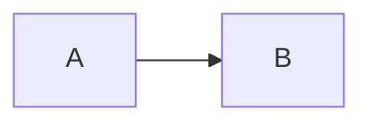

# Sampler page

A paragraph with a [relative link](../about/cite-and-licence.md), a [bare link](what-a-skill-is.md), a [nested bare link](get-started/get-data.md), a [site link](/data), an [anchor](#step-2-change-the-years), and an [external link](https://www.oecd.org/en/about/terms-conditions.html). It has "typed quotes", it's an apostrophe, `inline code`, `[not a link](x.md)`, *emphasis* and **bold**. The year ends 1960. Then more.

Escapes Google adds: spec_id, Chat + Canvas, oda-* skills, apis#981, (item 8), Value = 0. A bare URL https://docs.one.org/methodologies/ and an address data@one.org. Check the `Authorization` header reads `Bearer ` followed by the token.

A soft-wrapped paragraph whose first line ends here
and whose second line ends the paragraph.

A paragraph with a hard break  
and its second line.

<!-- TODO: a top-level author note with `code`, a [link](../build/share.md) and <dfo-site>. -->

## Step 2: change the years

!!! tip
    Under the sentence, "Why these results?" opens the steps /data took.

!!! note
    First callout paragraph with 60 observations. <!-- TODO: an inline note in a callout. -->

    Second callout paragraph.

    - A list inside a callout
    - Second item

    <!-- TODO: verify on the staging site that the panel shows 60. -->

!!! warning
    - A callout that opens with a list
    - Second item

!!! tip
An unindented callout body.

> Total population in Kenya, 2000 to 2024, according to 4 sources.

1. Clone the skills repository.

   ```bash
   git clone --depth 1 https://github.com/DevelopmentFinanceObservatory/skills.git
   ```

1. Copy the skills into a skills folder.

   :::tabs

   ::tab{label="For every session"}

   ```bash
   mkdir -p ~/.claude/skills
   ```

   ::tab{label="For one project"}

   Run this from the project root:

   ```bash
   mkdir -p .claude/skills
   ```

   :::

   The `_template` directory holds the files for creating a new skill.

1. Start a new Claude Code session. <!-- TODO: an inline note on a list item. -->

- Outer item one
  - Nested item a
    - Deep item i
  - Nested item b
- Outer item two
  <!-- TODO: a standalone note inside a list item -->

````markdown
# Nested fence

```python
print("inner")
```
````

```json title=".mcp.json"
{"a": 1}
```

| **Task**                                           | Use                              | Start here                          |
| -------------------------------------------------- | -------------------------------- | ----------------------------------- |
| CRS disbursements to Nigeria as CSV                | Search on [/data](/data)         | [Get data](get-started/get-data.md) |
| Let an AI assistant query development finance data | The DFO MCP server <!-- TODO: link when the MCP endpoint and its guide are public --> | The MCP server guide |



## Next

- [Share live data or a snapshot](../build/share.md) explains when to share a live link.
- [The data bundle](../data/bundle.md) describes every file in the ZIP.
